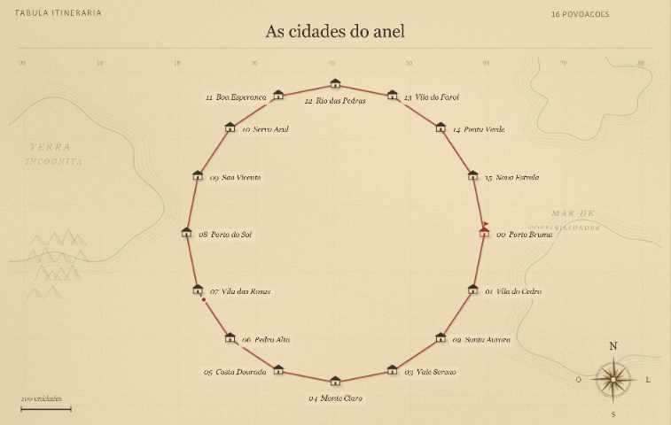
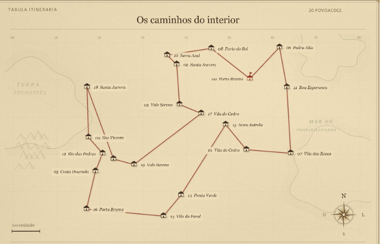
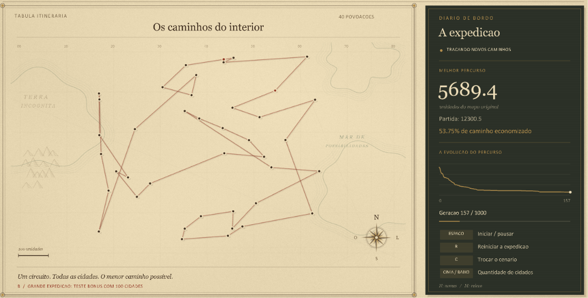
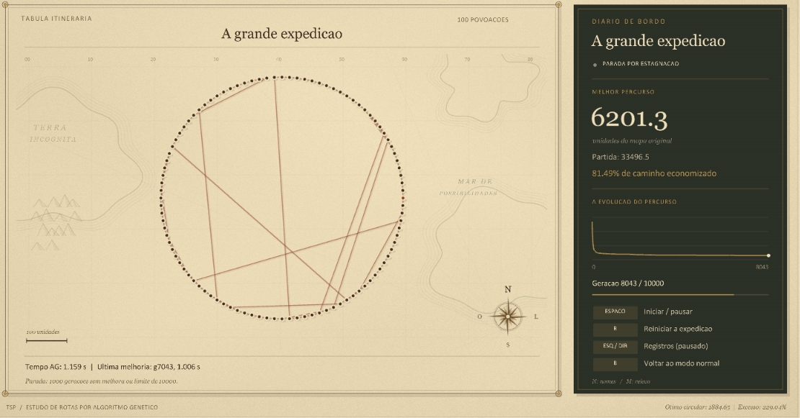

<div align="center">

# O Atlas das Rotas

### TSP · Algoritmo Genético · Simulação Visual


Uma aplicação em C++ para acompanhar a evolução de rotas no Problema do Caixeiro Viajante.<br>
Dois cenários, duas interfaces e um mesmo algoritmo genético.

[Visão geral](#visao-geral) ·
[Galeria](#galeria) ·
[Algoritmo](#algoritmo) ·
[Teste bônus](#teste-bonus) ·
[Compilação](#compilacao) ·
[Controles](#controles)

</div>

---

<a name="visao-geral"></a>

## 🧭 Visão geral

O objetivo do **Problema do Caixeiro Viajante (TSP)** é encontrar um percurso fechado que visite todas as cidades uma única vez e retorne ao ponto inicial, minimizando a distância total.

Neste projeto, as cidades são pontos em duas dimensões. Um algoritmo genético evolui uma população de percursos, enquanto a interface mostra a melhor rota encontrada, sua distância e o histórico de melhoria.

| Recurso | Implementação |
|---|---|
| Visualização em tempo real | Cidades, melhor rota e geração atual |
| Dois cenários | Pontos em uma circunferência ou distribuídos uniformemente |
| Quantidade ajustável | De 8 a 100 cidades, em incrementos definidos pela interface |
| Acompanhamento da evolução | Distância inicial, melhor distância, redução percentual e gráfico |
| Teste bônus | 100 cidades, tempo de evolução e registros intermediários |
| Referência no cenário circular | Comparação da distância encontrada com o ótimo conhecido |
| Interface Atlas | Papel envelhecido, cidades ilustradas e diário de bordo |

### Duas apresentações do projeto

| Versão | Branch | Proposta |
|---|---|---|
| **Atlas** | [`main`](https://github.com/cauanzzz/tsp-genetic-algorithm/tree/main) | Interface de portfólio inspirada em mapas antigos. |
| **Acadêmica** | [`entrega-professor`](https://github.com/cauanzzz/tsp-genetic-algorithm/tree/entrega-professor) | Interface direta para apresentação das rotas, métricas e experimentos. |

As versões compartilham `city.hpp` e `genetic.hpp`. A diferença está na interface de `main.cpp`.

No Atlas, os nomes das cidades e o relevo são fictícios. Eles não alteram as coordenadas nem o cálculo das distâncias. A textura de papel é gerada pelo código; não há dependência de imagens externas para executar a aplicação.

<a name="galeria"></a>

## 📸 Galeria

<table>
  <tr>
    <td colspan="2" align="center">
      <a href="docs/images/atlas-circular.png">
        
      </a>
      <br>
      <strong>01 — ATLAS · CENÁRIO CIRCULAR</strong>
      <br>
      <em>Distribuição regular das cidades e comparação com o ótimo conhecido.</em>
      <br><br>
    </td>
  </tr>
  <tr>
    <td width="50%" align="center">
      <a href="docs/images/atlas-uniforme.png">
        
      </a>
      <br>
      <strong>02 — ATLAS · CENÁRIO UNIFORME</strong>
      <br>
      <em>Evolução do percurso em uma distribuição irregular.</em>
      <br><br>
    </td>
    <td width="50%" align="center">
      <a href="docs/images/versao-academica.png">
        
      </a>
      <br>
      <strong>03 — INTERFACE ACADÊMICA</strong>
      <br>
      <em>Rotas e métricas na versão destinada à avaliação.</em>
      <br><br>
    </td>
  </tr>
  <tr>
    <td colspan="2" align="center">
      <a href="docs/images/teste-bonus.png">
        
      </a>
      <br>
      <strong>04 — TESTE BÔNUS · 100 CIDADES</strong>
      <br>
      <em>Tempo acumulado, última melhoria e acompanhamento do experimento.</em>
      <br><br>
    </td>
  </tr>
</table>

As imagens podem ser abertas em tamanho original clicando sobre cada captura.

## Primeiro experimento

1. Abra a aplicação no cenário circular inicial, com **16 cidades**.
2. Pressione **Espaço** para iniciar a evolução.
3. Observe a redução da distância e a mudança do percurso.
4. Pause com **Espaço** para inspecionar a rota.
5. Pressione **C** para testar o cenário uniforme.
6. Use **↑ / ↓** para alterar a quantidade de cidades.
7. Pressione **B** para abrir o teste bônus e **Espaço** para executá-lo.

> **Melhorar uma rota não significa encontrar o ótimo.** O cenário circular permite comparar o resultado com uma referência conhecida; no cenário uniforme, a interface acompanha a melhoria em relação à população inicial.

<a name="algoritmo"></a>

## 🧬 Algoritmo genético

### Representação e função de aptidão

Cada indivíduo representa uma **permutação dos índices das cidades**. A ordem dos genes define a sequência de visita:

```text
Genoma:    [3, 0, 2, 1]
Percurso:   3 → 0 → 2 → 1 → 3
```

O retorno à primeira cidade é incluído na avaliação, sem repetir esse índice no genoma. A distância total soma as distâncias euclidianas entre cidades consecutivas e o fechamento do circuito.

```text
fitness = 1 / distância total
```

Quanto menor a distância, maior a aptidão. Quando a distância total é zero, o código atribui fitness zero para evitar divisão por zero.

### Operadores

| Etapa | Funcionamento |
|---|---|
| **Inicialização** | Embaralhamento dos índices para criar a população inicial. |
| **Seleção por torneio** | Melhor indivíduo entre 5 sorteios, com possibilidade de repetição. |
| **Order Crossover (OX)** | Preserva um trecho de um pai e completa a rota na ordem do outro, sem repetir cidades. |
| **Mutação por troca** | Sorteia duas posições para uma possível troca. |
| **Elitismo** | Preserva o melhor indivíduo na próxima geração. |
| **Avaliação** | Recalcula a distância e o fitness dos novos indivíduos. |

### Parâmetros utilizados

| Parâmetro | Valor |
|---|---:|
| População | 100 indivíduos |
| Limite no modo normal | 1.000 gerações |
| Probabilidade de crossover | 85% por filho |
| Probabilidade de tentar a mutação | 8% por filho |
| Torneio | 5 sorteios |
| Indivíduos preservados pelo elitismo | 1 |
| Seed dos cenários e do algoritmo | 42 |

<details>
<summary><strong>Decisões de implementação e escolha dos parâmetros</strong></summary>

A população de 100 indivíduos é uma configuração inicial para explorar diferentes percursos mantendo o custo compatível com a visualização. O limite de 1.000 gerações define um orçamento fixo para o modo normal e facilita comparar execuções sob os mesmos parâmetros.

O crossover de 85% favorece a recombinação das rotas. A mutação de 8% introduz alterações ocasionais para ampliar a exploração; ela é aplicada à tentativa de mutação de cada filho, e não a 8% de seus genes. Como as posições são sorteadas independentemente, elas podem coincidir e a troca não modificar a rota.

A permutação, o OX e a mutação por troca foram escolhidos para preservar soluções válidas, sem repetição de cidades. O elitismo mantém a melhor solução disponível entre gerações.

Esses parâmetros são escolhas iniciais, não valores comprovadamente ótimos. Sua adequação depende de experimentos com diferentes quantidades de cidades, cenários e seeds.

O gerador pseudoaleatório utilizado é `std::mt19937`. Reiniciar com a mesma seed e os mesmos parâmetros repete o experimento no mesmo ambiente. As distribuições e o embaralhamento da biblioteca C++ podem variar entre implementações, portanto os resultados não são necessariamente idênticos entre plataformas.

</details>

## Cenários e leitura dos resultados

| Cenário | Distribuição | Referência |
|---|---|---|
| **Circular** | Pontos igualmente espaçados em uma circunferência. | Percorrer os pontos na ordem da circunferência produz uma solução ótima. |
| **Uniforme** | Coordenadas sorteadas uniformemente dentro da área definida. | Comparação com a melhor rota da população inicial. |

A redução percentual exibida é calculada por:

```text
redução (%) = (distância inicial − distância encontrada) / distância inicial × 100
```

Ela mede a melhoria em relação à melhor solução inicial, não a proximidade do ótimo.

No Atlas e no teste bônus acadêmico, o cenário circular também permite consultar o **excesso de distância sobre o ótimo**. Essa referência usa as coordenadas originais, independentemente da escala do mapa.

Ao consultar um registro intermediário, a rota e a distância correspondem à geração selecionada. O gráfico mantém o histórico completo e os indicadores de tempo mostram os totais do teste.

<a name="teste-bonus"></a>

## ⏱ Teste bônus

O teste utiliza **100 cidades no cenário circular**, com os mesmos operadores genéticos do modo normal. Pressione **B** para abri-lo e **Espaço** para iniciar.

| Configuração | Valor |
|---|---|
| Limite de gerações | 10.000 |
| Parada por estagnação | 1.000 gerações sem melhoria significativa |
| Tolerância de melhoria | Redução absoluta maior que `1e-8` |
| Registros intermediários | Geração 0, geração 100, múltiplos de 500 e geração final |
| Ritmo de evolução | Até 10 gerações por quadro |

A referência de melhoria é atualizada quando a redução acumulada desde a última melhoria significativa supera a tolerância. O teste termina por estagnação ou ao atingir o limite de gerações, o que ocorrer primeiro.

### O que é acompanhado

- Tempo acumulado da evolução e da busca do melhor indivíduo.
- Geração e tempo acumulado da última melhoria significativa.
- Distância encontrada e comparação com o ótimo circular.
- Rotas intermediárias, consultadas com **← / →** enquanto o teste está pausado ou encerrado.

O cronômetro exclui desenho, espera pelos FPS, pausas e inicialização. O tempo até a parada por estagnação inclui as gerações usadas para confirmar a ausência de melhora, por isso pode ser maior que o tempo da última melhoria.

> **Estagnação é um critério de parada, não uma prova de ótimo.** Os registros permanecem em memória e são descartados ao reiniciar, trocar de modo ou fechar a aplicação. Esta versão não exporta CSV.

<a name="compilacao"></a>

## 🛠 Compilação e execução

### Ambiente e pré-requisitos

| Componente | Utilização |
|---|---|
| **C++17** | Simulação e algoritmo genético. |
| **Raylib** | Janela, desenho 2D, fontes e teclado. |
| **GCC / MinGW-w64** | Compilação para Windows, no ambiente MSYS2 UCRT64. |
| **VS Code** | Edição, IntelliSense e tarefa de build. |
| **Git** | Versionamento e seleção da interface. |

O `g++` deve estar disponível no `PATH`. Os headers da Raylib ficam em `include/` e a biblioteca estática em `lib/libraylib.a`, compatível com o compilador e a arquitetura utilizados.

O build fornecido é para **Windows** e não utiliza CMake nem Makefile.

### 1. Obter o projeto

```bash
git clone https://github.com/cauanzzz/tsp-genetic-algorithm.git
cd tsp-genetic-algorithm
```

A branch padrão é a versão Atlas. Para utilizar a interface acadêmica:

```bash
git switch entrega-professor
```

Para retornar ao Atlas:

```bash
git switch main
```

### 2. Compilar

Execute na raiz do projeto:

```bash
g++ -std=c++17 -O2 -Iinclude -Llib main.cpp -o main.exe -lraylib -lopengl32 -lgdi32 -lwinmm -static -static-libgcc -static-libstdc++
```

No VS Code, a tarefa de build também pode ser executada com **Ctrl + Shift + B**.

### 3. Executar

No PowerShell:

```powershell
.\main.exe
```

No terminal MSYS2:

```bash
./main.exe
```

**Recompile após trocar de branch:** o executável anterior pode pertencer à outra interface.

O Atlas utiliza uma janela de **1440 × 900**, e a versão acadêmica, **1200 × 720**, com alvo de 60 FPS. O Atlas tenta carregar Georgia e Calibri do Windows e utiliza a fonte padrão da Raylib quando necessário. Não é preciso baixar fontes adicionais.

<a name="controles"></a>

## 🎮 Controles

| Tecla | Ação |
|---|---|
| **Espaço** | Iniciar ou pausar a evolução. |
| **R** | Reiniciar a simulação ou o teste atual. |
| **C** | Alternar cenário no modo normal. |
| **↑ / ↓** | Alterar a quantidade de cidades no modo normal. |
| **B** | Entrar ou sair do bônus, reiniciando a simulação. |
| **← / →** | Consultar registros do bônus enquanto estiver pausado ou encerrado. |
| **N** | Mostrar ou ocultar nomes no Atlas. |
| **M** | Mostrar ou ocultar o relevo no Atlas. |
| **Esc** | Fechar a aplicação. |

No Atlas, os nomes aparecem com até 20 cidades, quando há espaço. O hover permite identificar os pontos também com quantidades maiores.

## Organização do código

| Arquivo ou pasta | Responsabilidade |
|---|---|
| `main.cpp` | Interface, controles, execução da simulação e teste bônus. |
| `city.hpp` | Pontos 2D, geração dos cenários e matriz de distâncias. |
| `genetic.hpp` | Indivíduos, parâmetros e operadores genéticos. |
| `include/` | Headers locais da Raylib. |
| `lib/libraylib.a` | Biblioteca estática utilizada na linkagem. |
| `.vscode/tasks.json` | Tarefa de compilação. |
| `.vscode/c_cpp_properties.json` | Configuração do IntelliSense. |
| `docs/images/` | Capturas utilizadas na galeria. |

O executável `main.exe` é gerado pelo build e está configurado para ser ignorado pelo Git.

## Limitações

- O algoritmo genético é uma heurística e não garante encontrar a solução ótima.
- População, crossover, mutação e demais parâmetros do AG são definidos no código.
- A seed fixa favorece repetição; avaliar robustez exige testes com outras seeds.
- O tempo medido depende do hardware, compilador e opções de otimização.
- Não há exportação dos registros, que são mantidos apenas durante o teste.
- O build atual é específico para Windows. Outros sistemas exigem uma biblioteca Raylib compatível e ajustes de linkagem.

---

